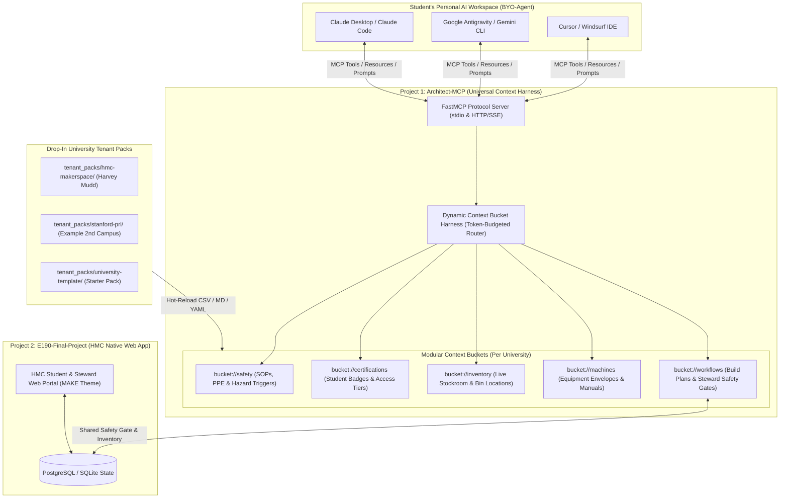

# Implementation Plan: Architect-MCP — Portable University Makerspace Context Harness & MCP Server

> **Project Identity**: **Architect-MCP** (`Agentic Hardware Assembly Assistant`)  
> **Project Folder**: `/Users/nathannoronha/E190BO-FINAL-PROJECT/Architect-MCP`  
> **Companion Campus Web App**: `/Users/nathannoronha/E190BO-FINAL-PROJECT/E190-Final-Project` (*Harvey Mudd College Native Web Portal*)

---

## 1. Executive Vision & Dual-Project Architecture

During the Harvey Mudd E190 prototype presentation, a key architectural insight emerged: while a dedicated web portal (`E190-Final-Project`) is ideal for Harvey Mudd's shop floor and steward check-off tablets, **the core intelligence—safety protocols, machine certifications, live component stock, and step-by-step build decomposition—can be decoupled into a portable Model Context Protocol (MCP) server**.

By separating **Architect** into two complementary projects, you get the best of both worlds:

1. **`Architect-MCP` (This Folder — Portable Multi-University MCP Server & Context Harness)**:
   - A plug-and-play **Model Context Protocol (MCP)** server (`stdio` + `Streamable HTTP/SSE`) that connects to **any student's personal AI agent** (Claude Desktop, Claude Code CLI, Google Antigravity, Cursor, Windsurf, or ChatGPT Desktop).
   - Features a **Custom Context Harness** that dynamically organizes institutional makerspace knowledge into **modular context buckets** (`safety`, `certifications`, `inventory`, `machines`, `workflows`), serving only the relevant, token-budgeted slices to the host LLM.
   - **100% University-Agnostic**: Any college makerspace can deploy `Architect-MCP` in minutes by dropping their CSV inventory, Markdown safety SOPs, and YAML certification rules into a `tenant_packs/<university>/` folder—zero frontend or LLM code changes required.
2. **`E190-Final-Project` (Existing Folder — HMC Native "MAKE / Architect" Web App)**:
   - Remains your dedicated **Harvey Mudd College campus web application** with its tailored UI, visual BOM/Stockroom explorer, and mobile Shop Steward sign-off queue.
   - Can optionally consume the `Architect-MCP` context harness or share the HMC SQLite/PostgreSQL database so a student who plans a build in Claude Desktop immediately sees their safety sign-off request appear on the HMC Shop Steward's tablet in the web app.



---

## 2. How the Custom Context Harness Works ("Modular Buckets")

A naive RAG or system-prompt dump fails for university makerspaces because dumping 1,000+ inventory SKUs, 40 pages of safety SOPs, and 30 machine manuals into every turn blows up the host model's context window and causes the LLM to miss critical safety rules.

**Architect-MCP solves this with a deterministic Context Harness (`architect_mcp/harness/`)** that partitions makerspace context into **5 typed buckets** and dynamically composes a bounded context window based on the student's query and subsystem intent:

| Bucket URI | Bucket Name | Source Formats | What It Serves to the Host LLM | Context Pruning Strategy |
| :--- | :--- | :--- | :--- | :--- |
| `bucket://safety` | **Safety & Hazard Protocols** | `.md`, `.yaml` | Mandatory PPE, forbidden materials (e.g., no PVC in laser cutters), high-voltage rules (>50V), and automatic **Steward Sign-Off** triggers. | **Always-On Core + Machine-Matched**: Global shop rules are pinned; machine-specific SOPs load only when a step references that tool. |
| `bucket://certifications` | **Certifications & Access Tiers** | `.yaml`, DB/JSON | Required training badges per machine (e.g., *General Orientation*, *Laser 101*, *Mill/Lathe Green Tag*) + optionally the active student's earned certs. | **Filtered by Equipment & Student ID**: Injects only the cert requirements for tools in the active build plan and flags any missing badges. |
| `bucket://inventory` | **Live Stockroom & Materials** | `.csv`, Postgres/SQLite | Real-time stock quantities (`High`, `Low`, `3/8`), exact room/cabinet locations (`Main Area & Cage -> Cabinet 11 -> Top`), and SKUs. | **Keyword + Subsystem Retrieval**: Queries only matching fasteners, raw stock, sensors, or tools instead of dumping all 1,020+ rows. |
| `bucket://machines` | **Equipment, Areas & Manuals** | `.yaml`, `.md` | Work envelopes, materials allowed, speeds/feeds, operational status (`Operational` vs. `Down`), and direct links to setup videos/manuals. | **Capability-Matched**: Loads specs only for machines relevant to the project's subsystems (`Mechanical`, `Electrical`, `Firmware`, `Wood`). |
| `bucket://workflows` | **Build Steps & Steward Gates** | Postgres / SQLite | Persistent project decomposition, step completion state, and live **Shop Steward check-off locks** (`PENDING`, `APPROVED`, `FLAGGED`). | **Active Project State**: Keeps the student's current build checklist synchronized across chat turns and with the campus Steward queue. |

---

## 3. MCP Specification: Tools, Resources, and Prompts

When a student connects `Architect-MCP` to Claude Desktop, Claude Code, Cursor, or Antigravity, their personal agent automatically discovers the following capabilities:

### 3.1 MCP Tools (Executable by the Host LLM)

1. **`assemble_context_harness`** *(Signature Context Bucket Orchestrator)*
   - **Inputs**: `project_description: str`, `subsystems: list[str]`, `student_id: Optional[str]`, `token_budget: int = 4000`
   - **Behavior**: Inspects the student's hardware goal, pulls matching slices from all 5 buckets (`safety`, `certifications`, `inventory`, `machines`, `workflows`), enforces the `token_budget` with priority weighting (`safety` > `certifications` > `machines` > `inventory`), and returns a structured, citation-tagged context payload for the host LLM.
2. **`search_makerspace_inventory`**
   - **Inputs**: `query: str`, `area: Optional[str]`, `only_in_stock: bool = False`
   - **Behavior**: Searches `bucket://inventory` for components, raw stock, or tools; returns live quantity status (`High`, `Low`, `3/8`), exact bin/cabinet path, and required role/certification.
3. **`check_machine_and_certification`**
   - **Inputs**: `machine_or_process: str`, `student_id: Optional[str]`
   - **Behavior**: Queries `bucket://machines` and `bucket://certifications` to report whether the machine is operational, its work envelope/manual link, whether the student holds the required certification badge, and whether a Shop Steward sign-off is mandatory.
4. **`save_hardware_build_plan`**
   - **Inputs**: `title: str`, `student_id: str`, `steps: list[StepInput]`, `bom_items: list[BOMInput]`
   - **Behavior**: Validates every proposed step against `bucket://safety` (automatically setting `requires_steward_signoff = True` if a step touches a lathe, mill, table saw, welder, or >50V electronics) and persists the build plan to `bucket://workflows` (PostgreSQL/SQLite).
5. **`request_steward_safety_signoff`**
   - **Inputs**: `project_id: int`, `step_order: int`, `student_id: str`, `ppe_verified: bool`, `setup_summary: str`
   - **Behavior**: Places the hazardous step into the Shop Steward approval queue and returns the current safety gate status.
6. **`complete_build_step`**
   - **Inputs**: `project_id: int`, `step_order: int`, `student_id: str`
   - **Behavior**: Marks a step complete **only if** `requires_steward_signoff == False` or a Shop Steward has already approved the step (`safety_approved_by != None`). Otherwise returns an explicit safety gate block explaining what steward check-off is needed.
7. **`ingest_university_bucket`** *(Admin / Steward Tool)*
   - **Inputs**: `university_slug: str`, `bucket_name: str`, `source_path: str`
   - **Behavior**: Parses and hot-reloads a university's updated inventory CSV, safety Markdown, or machine YAML into the active tenant pack and validates schema completeness.

### 3.2 MCP Resources (Direct Context Inspection)

- `architect://tenant/info` — Active university metadata, campus areas, hours, and emergency contacts.
- `architect://buckets/safety/all` — Full safety protocol index for the active campus.
- `architect://buckets/certifications/matrix` — Complete machine-to-certification requirement matrix.
- `architect://buckets/machines/catalog` — List of campus machines, areas, and operational statuses.
- `architect://buckets/inventory/summary` — Stockroom categories, total SKU counts, and low-stock alerts.
- `architect://projects/{project_id}` — Live build plan, BOM availability, and steward sign-off state.

### 3.3 MCP Prompts (One-Click Slash Commands in Host Agents)

- **`/architect-build-plan`** (`project_idea`, `student_email`): Instructs the host LLM to call `assemble_context_harness`, verify campus stock and certifications, generate a step-by-step assembly plan with explicit safety gates, and persist it via `save_hardware_build_plan`.
- **`/shop-safety-precheck`** (`machine_name`, `material`): Runs a strict pre-flight safety & certification check before a student approaches a machine.
- **`/bom-stockroom-audit`** (`bom_list`): Splits a bill of materials into "Free & In-Stock on Campus (with Cabinet/Bin location)" vs. "Must Order Externally."

---

## 4. Directory Structure for `Architect-MCP`

Everything for this new project lives inside `/Users/nathannoronha/E190BO-FINAL-PROJECT/Architect-MCP`, completely cleanly separated from `/Users/nathannoronha/E190BO-FINAL-PROJECT/E190-Final-Project`:

```text
/Users/nathannoronha/E190BO-FINAL-PROJECT/Architect-MCP/
├── IMPLEMENTATION_PLAN.md           # This execution roadmap
├── README.md                        # Quickstart for students, universities & IDE setup
├── CLAUDE.md                        # Strict engineering rules for the MCP project
├── pyproject.toml                   # Python package & CLI entrypoints (`architect-mcp`)
├── .env.example                     # ARCHITECT_TENANT=hmc-makerspace, DATABASE_URL, etc.
├── architect_mcp/
│   ├── __init__.py
│   ├── server.py                    # FastMCP server (Tools, Resources, Prompts)
│   ├── config.py                    # Env config & active university tenant loader
│   ├── db.py                        # SQLite (default portable) or PostgreSQL (shared with HMC web app)
│   ├── models.py                    # SQLModel schemas (Tenant, BucketItem, Project, Step, Cert, Inventory)
│   ├── harness/                     # THE CUSTOM CONTEXT HARNESS
│   │   ├── __init__.py
│   │   ├── bucket_manager.py        # Loads & indexes the 5 modular buckets per university
│   │   ├── router.py                # Intent & subsystem scorer (selects relevant bucket slices)
│   │   ├── token_budget.py          # Deterministic token packer with safety-first priority
│   │   └── safety_validator.py      # Deterministic hazard regex/rule scanner for build steps
│   └── loaders/                     # Multi-Format University Data Ingestors
│       ├── csv_inventory_loader.py  # Ingests makerspace CSVs (e.g. make.hmc.edu export)
│       ├── markdown_sop_loader.py   # Chunks safety Markdown / SOP manuals with frontmatter
│       └── yaml_config_loader.py    # Loads campus.yaml, certs.yaml, and machines.yaml
├── tenant_packs/                    # DROP-IN UNIVERSITY CONFIGURATIONS
│   ├── hmc-makerspace/              # Tenant 1: Harvey Mudd College (MAKE + Machine Shop)
│   │   ├── campus.yaml              # Areas: Main Area & Cage, Machine Shop, Wood Shop, EE Stockroom
│   │   ├── safety/                  # HMC safety rules, PPE, steward sign-off rules
│   │   ├── certifications/          # HMC General Cert, Laser, Mill/Lathe, 3D Printing, Sewing
│   │   ├── machines/                # HMC equipment (Juki LSM, Brother PE800, Prusa, Bridgeport, etc.)
│   │   └── inventory/               # HMC 1,020-item inventory schema (Locations, High/Low, Roles)
│   └── mit-makerworks-demo/         # Tenant 2: Second University Pack (proves instant portability!)
│       ├── campus.yaml
│       ├── safety/
│       ├── certifications/
│       ├── machines/
│       └── inventory/
└── tests/
    ├── test_context_harness.py      # Verifies bucket isolation, token budgeting & safety pinning
    ├── test_mcp_tools.py            # End-to-end tool call tests (inventory, certs, build plans)
    ├── test_safety_gates.py         # Verifies steward sign-off blocks unapproved hazardous steps
    └── test_tenant_portability.py   # Hot-swaps from HMC to MIT tenant pack and verifies outputs
```

---

## 5. Vertical Slice Roadmap (Step-by-Step Build Plan)

We can build `Architect-MCP` in **5 focused vertical slices** (each testable in under 2 seconds via `pytest`):

### Slice 1: Modular Context Bucket Schemas & University Tenant Loader
- **Goal**: Build the data foundation and prove that a university can define its makerspace entirely via drop-in files (`YAML` + `Markdown` + `CSV`).
- **Deliverables**:
  - `architect_mcp/models.py` & `architect_mcp/loaders/` (`yaml_config_loader.py`, `markdown_sop_loader.py`, `csv_inventory_loader.py`).
  - Two complete tenant packs in `tenant_packs/`:
    1. `hmc-makerspace` (modeled directly on `make.hmc.edu` — areas like *Main Area & Cage*, *Electronics Bench*, *Machine Shop*; items with `High`/`Low`/`3/8` quantities, cabinet locations, and `User`/`Steward` roles; real HMC machines and safety rules).
    2. `mit-makerworks-demo` (a second university profile with different machines, certs, and inventory to demonstrate instant multi-college switching).
  - Unit tests verifying zero-code onboarding of a new university folder.

### Slice 2: The Dynamic Context Harness (`bucket_manager`, `router`, `token_budget`)
- **Goal**: Implement the core innovation from your resume—the **Custom Context Harness** that organizes the LLM context window into modular buckets and packs them within a strict token budget.
- **Deliverables**:
  - `architect_mcp/harness/bucket_manager.py`: Registers and indexes `bucket://safety`, `bucket://certifications`, `bucket://inventory`, `bucket://machines`, and `bucket://workflows`.
  - `architect_mcp/harness/router.py` & `token_budget.py`: Given a natural-language build prompt (e.g., *"I want to build a 48V brushless motor dyno with an aluminum mounting plate and stitched leather tether"*), scores and retrieves only the matching safety rules, required certs, operational machines, and in-stock parts while guaranteeing `bucket://safety` is never truncated.
  - `architect_mcp/harness/safety_validator.py`: Deterministically flags steps involving mills, lathes, laser cutters, table saws, welders, or high voltage for mandatory Shop Steward check-off.

### Slice 3: FastMCP Server (`Tools`, `Resources`, `Prompts`)
- **Goal**: Expose the Context Harness over the standard Model Context Protocol (`mcp` Python SDK) so Claude Desktop, Claude Code CLI, Cursor, and Antigravity can plug right in.
- **Deliverables**:
  - `architect_mcp/server.py` implementing all 7 MCP Tools, 6 MCP Resources, and 3 MCP Prompts.
  - Ready-to-copy client configuration snippets (`claude_desktop_config.json`, `.mcp.json` for Claude Code / Cursor, and Antigravity MCP config) so any student can connect their personal agent in 30 seconds.

### Slice 4: Persistent Build Plans, Safety Gate Workflows & HMC Web App Bridge
- **Goal**: Connect natural-language build plans generated in a student's personal AI agent to durable database state (`SQLite` standalone or shared `PostgreSQL` with `E190-Final-Project`).
- **Deliverables**:
  - Durable persistence for `save_hardware_build_plan`, `request_steward_safety_signoff`, and `complete_build_step`.
  - Optional shared-database bridge (`DATABASE_URL`) so a build plan created inside Claude Code or Antigravity via `Architect-MCP` immediately appears inside your Harvey Mudd `E190-Final-Project` web app for Shop Steward review!

### Slice 5: CLI Admin Utility (`architect-admin`) & End-to-End Compliance Suite
- **Goal**: Give makerspace directors a 1-command CLI (`architect-mcp validate-pack`, `architect-mcp ingest-csv`, `architect-mcp inspect-harness`) to test their university's buckets and verify full compliance.
- **Deliverables**:
  - CLI command suite + comprehensive `pytest` suite (`tests/test_context_harness.py`, `tests/test_mcp_tools.py`, `tests/test_safety_gates.py`, `tests/test_tenant_portability.py`).

---

## 6. How Both Projects Work Together in Your Portfolio & Demo

Having both folders side by side gives you a killer live demo story for E190 and engineering interviews:

1. **Part 1 — The Universal MCP Engine (`Architect-MCP`)**:
   - Show a student opening **Claude Code / Claude Desktop / Antigravity** and typing:  
     *"Use Architect to plan a custom PCB enclosure and machined heatsink using parts in stock at my university."*
   - Show the agent calling `assemble_context_harness`, pulling live stock from `bucket://inventory`, checking certifications in `bucket://certifications`, and generating a build plan with automatic safety locks from `bucket://safety`.
   - Switch `ARCHITECT_TENANT=mit-makerworks-demo` and run the exact same prompt to prove how the build plan automatically adapts to a completely different university's stockroom and safety rules!
2. **Part 2 — The Harvey Mudd Native Portal (`E190-Final-Project`)**:
   - Open the **Harvey Mudd web app** (`http://127.0.0.1:8000`, styled after `make.hmc.edu`) to show the campus-specific interface where HMC students and Shop Stewards can visually browse stock, inspect 3D CAD, and sign off safety gates on the shop floor.

